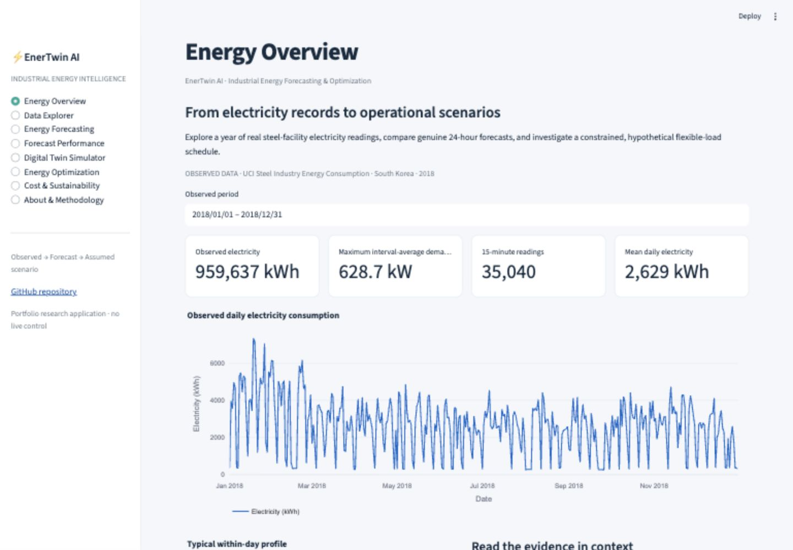
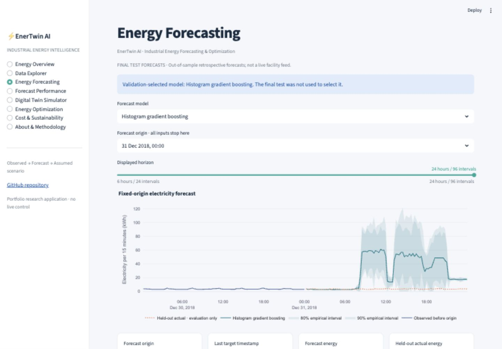
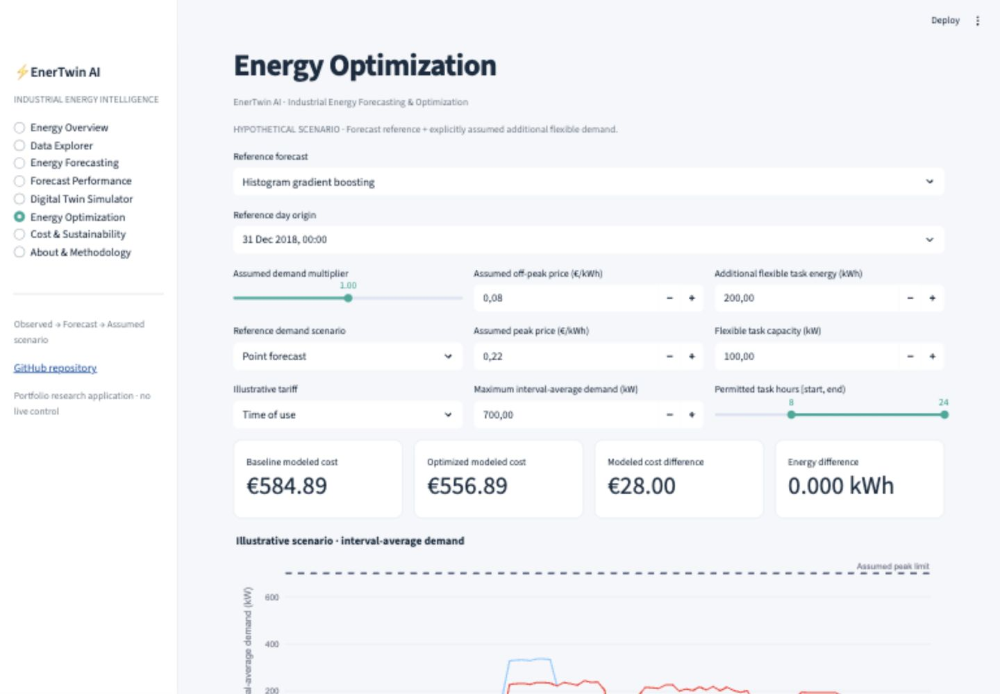

# EnerTwin AI

**Industrial Energy Forecasting, Digital Twin & Intelligent Operations Optimization**

[](https://github.com/Priynka-Roy/enertwin-industrial-energy-digital-twin/actions/workflows/ci.yml)

[Repository](https://github.com/Priynka-Roy/enertwin-industrial-energy-digital-twin) · [Open the local app](http://localhost:8502) · [Methodology](docs/METHODOLOGY.md) · [Computed results](docs/EXPERIMENT_RESULTS.md)

Energy planners need credible forecasts and clear scheduling trade-offs. EnerTwin AI analyzes real steel-facility electricity, evaluates complete 24-hour forecasts, and allocates explicitly hypothetical flexible work under energy, availability and power constraints. It distinguishes observed data, forecasts and modeled costs throughout the application.

The local-app link works after starting Streamlit on your own computer. Public hosting will be prepared together with the other portfolio application later; no hosted URL is claimed.

## What you can explore

Eight Streamlit sections cover Energy Overview, Data Explorer, Energy Forecasting, Forecast Performance, Digital Twin Simulator, Energy Optimization, Cost & Sustainability, and About & Methodology. Interactive Plotly charts connect historical profiles to model evaluation and simulated decisions. Four guided cases cover historical demand, next-day forecasting, time-of-use scheduling and cap sensitivity.

- True 96-step forecasts issued at midnight using historical demand and known calendar information.
- Persistence and daily/weekly seasonal baselines alongside Ridge and direct histogram gradient boosting.
- Chronological training, validation, calibration and final testing, with empirical pointwise and whole-day interval coverage.
- A SciPy HiGHS linear program for divisible workload allocation, with explicit feasible baseline, independent constraint checks and infeasibility reporting.
- Separate energy, average peak power, modeled electricity cost and assumed-factor emissions results.



## Real data, explicit boundaries

The [UCI Steel Industry Energy Consumption dataset](https://archive.ics.uci.edu/dataset/851/steel+industry+energy+consumption) contains 35,040 quarter-hour observations from one South Korean steel facility. The original CSV is preserved unchanged locally and excluded from Git. A documented correction moves 365 same-date midnight rows to the next day, restoring interval-end chronology without changing measured values.

Historical EDA includes distributions, operating categories, calendar variation, reactive energy, power factors and unusual readings. The [computed EDA report](reports/eda/EDA_REPORT.md) retains quantitative findings and diagnostic limitations.

Dataset attribution: Sathishkumar V E, Changsun Shin, and Yongyun Cho (2021), *Steel Industry Energy Consumption*, UCI Machine Learning Repository, [DOI 10.24432/C52G8C](https://doi.org/10.24432/C52G8C), [CC BY 4.0](https://creativecommons.org/licenses/by/4.0/). Committed data derivatives retain this attribution; code is MIT licensed. See [data card](docs/DATA_CARD.md).

Future observed reactive energy, power factors, CO2 and load-category labels are excluded from forecasts. The source CO2 header and documented unit conflict, so it is not treated as validated emissions. Load categories are observational rather than controllable production decisions.

## Evaluation and operations

Training uses January 8–June 30, 2018; July–August validation selects parameters; selected models are refitted through August; September calibrates uncertainty; October–December is the final test. At each daily origin, all 96 predictions are frozen together. [Evaluation details](docs/FORECAST_EVALUATION.md) explain metrics and dependence limitations. On 92 final-test days, selected gradient boosting achieved MAE **10.870** and RMSE **19.408 kWh/interval**, compared with weekly naive MAE **12.942**. Its nominal 90% pointwise band covered **78.70%** of intervals, below nominal. A separate nominal 90% day-block band covered complete profiles on **88.04%** of days, with much wider bands. [Experiment results](docs/EXPERIMENT_RESULTS.md) retain all models and limitations.

The October 1 tariff scenario reduces modeled total energy charges from **€360.00 to €332.00**, while conserving **1,819.52 kWh** and constant-factor emissions. A **190 kW** scenario cap binds the feasible reference. Cap/background sensitivity explicitly includes infeasible cases. These are hypothetical modeled comparisons, not measured factory savings.

The digital twin adds assumed flexible workload to a historical or forecast background. The optimizer minimizes `sum(price[t] * allocated_energy[t])` subject to workload completion, scheduling windows, per-task capacity and aggregate demand cap. `kW = interval_kWh / 0.25`. Both optimized and baseline schedules obey the same constraints. Rescheduling energy can alter cost without reducing kWh; a constant emissions factor produces no emissions saving from timing alone. See [formulation](docs/OPTIMIZATION_MODEL.md) and [digital twin](docs/DIGITAL_TWIN.md).





## Run locally

```bash
python3.12 -m venv .venv
source .venv/bin/activate
python -m pip install -e '.[dev]'
streamlit run streamlit_app.py --server.port 8502
```

Startup uses committed lightweight artifacts; it does not download private files or train models. Python, NumPy, pandas, scikit-learn, SciPy HiGHS, statsmodels, Plotly, Streamlit, pytest and Ruff form the stack. Version pins are in `requirements.txt`.

## Reproduce and inspect

Reproduce all artifacts with:

```bash
python scripts/download.py
python scripts/run_pipeline.py
python -m pytest -q
python -m ruff check .
```
 The experiment script records source checks, exact split boundaries, seeds, model settings, metrics and scenario outputs. Run `python -m pytest -q` and `python -m ruff check .` for validation. CI uses deterministic fixtures and deployment artifacts rather than requiring raw telemetry.

```
app/             Interactive presentation
src/enertwin/    Ingestion, forecasting, evaluation and optimization
scripts/         Reproduction entry points
configs/         Recorded experiment/scenario assumptions
artifacts/       Lightweight fitted/evaluated outputs
reports/         Computed statistics and result tables
data/demo/      Attributed compact deployment data
docs/           Scientific and engineering documentation
tests/          Leakage, units, optimization and application checks
```

## Interpretation and next steps

This is an independently implemented portfolio project. A single plant-year is not external validation, and uncertainty bands have no exact temporal-dependence guarantee. The digital twin is a scenario simulator, with hypothetical workload, prices and emissions inputs; its financial differences are not realized savings. No industrial employer is a collaborator or endorser.

Further work should add plant-years, prospectively validate forecasts, obtain expert-reviewed operating constraints and evaluate decisions against real tariffs and uncertainty. [Limitations](docs/LIMITATIONS.md), [case study](docs/PORTFOLIO_CASE_STUDY.md), [final review](docs/FINAL_REVIEW.md) and [deployment preparation](docs/DEPLOYMENT.md) provide context.
