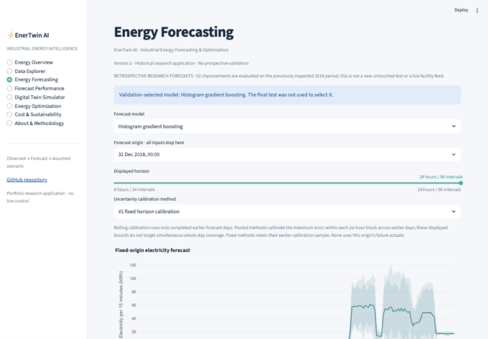
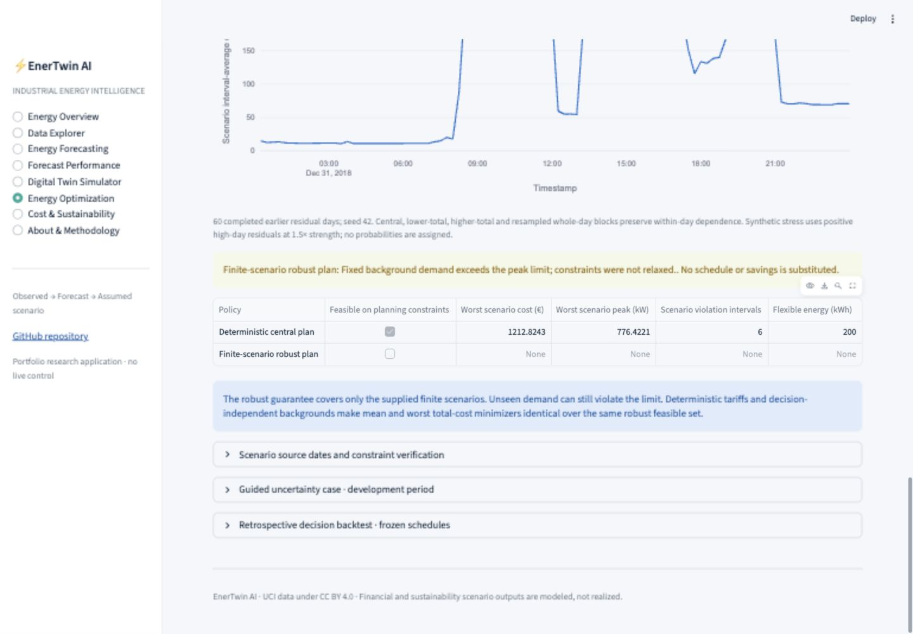

# EnerTwin AI · Version 2

**Industrial Energy Forecasting, Digital Twin & Intelligent Operations Optimization**

[](https://github.com/Priynka-Roy/enertwin-industrial-energy-digital-twin/actions/workflows/ci.yml)

[Repository](https://github.com/Priynka-Roy/enertwin-industrial-energy-digital-twin) · [Open the local app](http://localhost:8502) · [V2 results](docs/V2_RESULTS.md) · [Methodology](docs/V2_METHODOLOGY.md) · [Preserved V1](docs/V1_BASELINE.md)

EnerTwin AI analyzes real steel-facility electricity and explores scheduling additional hypothetical work under uncertain background demand. It issues genuine 24-hour forecasts, evaluates residual uncertainty and compares deterministic with finite-scenario robust workload allocation. Every result distinguishes observed data, forecasts, simulated scenarios and conditional modeled costs.

The local link opens the app after you start it on your own computer. Public hosting, the combined CV and the two-project portfolio website are planned for a later phase.

## What changed in Version 2

- Preserved V1 at `v1.0.0`, with artifacts, configuration, reports and documentation in `versions/v1/`.
- Retained all five point forecasters and frozen-origin 96-step predictions.
- Investigated fixed horizon-wise, fixed six-hour pooled and rolling six-hour pooled residual bands using earlier development dates.
- Added pointwise, six-hour and whole-day coverage, horizon errors, calendar/peak strata and interval-width stability diagnostics.
- Generated causal whole-day residual demand scenarios with recorded origins and an explicit synthetic stress path.
- Added a SciPy HiGHS robust LP issuing the **same schedule across every supplied scenario**.
- Backtested frozen deterministic/robust schedules on observed background plus identical hypothetical work, reporting issuance feasibility separately from cap violations.
- Expanded sensitivity, artifact compatibility and mathematical/application verification while retaining all eight app sections.

The eight sections are Energy Overview, Data Explorer, Energy Forecasting, Forecast Performance, Digital Twin Simulator, Energy Optimization, Cost & Sustainability, and About & Methodology. Startup loads lightweight committed artifacts; it does not download raw telemetry or fit models.





## Actual evidence and trade-offs

The unchanged V1 selected Gradient Boosting model achieved original October–December MAE **10.870** and RMSE **19.408 kWh/interval**, versus weekly seasonal naive MAE **12.942**. These dates have already been inspected: every new V2 comparison on them is **retrospective**, not new independent validation.

The causal development rule retains the narrower V1 fixed method as default. Rolling pooled calibration is an available alternative: its retrospective pointwise coverage at the nominal 90% six-hour score level was **97.93%**, with mean width **79.04 kWh**, versus V1 horizon-wise 90% coverage **78.70%** and width **41.63 kWh**. Wider pooled bands are conservative pointwise; their measured six-hour block coverage was **88.04%**, and whole-day coverage **61.96%**. Nominal bin-score levels and full-day probability are different targets. These empirical figures provide no exact guarantee under temporal dependence.

With the recorded twelve-path stress set, robust schedules were infeasible at 350 and 500 kW on every retrospective origin. At 700 kW they were feasible on **18 of 92 days**, versus deterministic feasibility on all 92. On the 18 paired feasible days, both policies had zero observed-background cap-violation days and identical mean modeled costs of **€214.42**. This experiment **does not establish a robust scheduling improvement**; it exposes a substantial conservatism/issuance trade-off. Infeasible days are not counted as safe schedules. [Full V2 results](docs/V2_RESULTS.md) show development and retrospective denominators, width costs and sensitivity.

The original V1 illustrative tariff case remains €360 baseline versus €332 optimized modeled cost, conserving 1,819.52 kWh. Timing changes cost without reducing energy; constant-factor emissions remain unchanged. No actual industrial savings are claimed.

## Real data and assumptions

The [UCI Steel Industry Energy Consumption dataset](https://archive.ics.uci.edu/dataset/851/steel+industry+energy+consumption) contains 35,040 quarter-hour records from one South Korean steel facility. A documented source-sequence repair moves 365 same-date midnight rows to the following interval-end day, without changing original measurements. Raw bytes remain preserved locally and excluded from Git.

Dataset attribution: Sathishkumar V E, Changsun Shin and Yongyun Cho (2021), *Steel Industry Energy Consumption*, UCI Machine Learning Repository, [DOI 10.24432/C52G8C](https://doi.org/10.24432/C52G8C), [CC BY 4.0](https://creativecommons.org/licenses/by/4.0/). Committed derivatives retain this attribution; code is MIT licensed. See [data card](docs/DATA_CARD.md).

Future observed load categories, reactive energy, power factors and CO2 never enter a forecast. The CO2 column header conflicts with the source's documented units; it is not validated emissions. Flexible workloads, windows, capacities, tariffs and emissions factors are explicitly assumed. The simulator adds new hypothetical work to whole-facility background; it does not infer a controllable production fraction.

## Optimization model

Decision variables allocate task energy in kWh. SciPy HiGHS minimizes assumed flexible energy charges while enforcing task completion, windows, per-task/shared capacities and total peak demand. `average kW = interval kWh / 0.25 h`. Reference schedules obey the same constraints. Work is continuously divisible and interruptible; no equipment physics or indivisible production batches are inferred.

Robust mode imposes the peak constraint for every included background path with one shared allocation. The componentwise maximum background is an exact LP constraint reduction, not a physical trajectory or a scenario-average cost. Fixed tariffs and additive exogenous background make separate mean/worst-cost/CVaR objectives uninformative over the same feasible set. Scenario means are descriptive, with no calibrated probabilities. See [LP formulation](docs/OPTIMIZATION_MODEL.md) and [digital twin](docs/DIGITAL_TWIN.md).

## Run locally

```bash
python3.12 -m venv .venv
source .venv/bin/activate
python -m pip install -e '.[dev]'
streamlit run streamlit_app.py --server.port 8502
```

Python 3.11 and 3.12 are supported by CI. Dependencies are pinned in `requirements.txt`. No credentials or private data are required for the app.

## Reproduce and verify

V2 reproduction uses the preserved V1 deployment data and results:

```bash
python scripts/run_v2.py
python -m pytest -q
python -m ruff check .
```

To reproduce the original source-based V1 experiment separately:

```bash
python scripts/download.py
python scripts/run_pipeline.py
```

The V1 script writes original root artifacts; V2 writes `artifacts/v2/`, `data/demo/v2/` and `reports/v2/`. Preserved `versions/v1/` files remain unchanged. The experiment registry records source hashes, seeds, settings, evaluation boundaries, library versions, scenario assumptions and output integrity. No expensive reproduction runs during application startup.

| Path | Purpose |
|---|---|
| `src/enertwin/` | Forecasting, calibration, scenario and LP modules |
| `app/` | Eight-section Streamlit presentation |
| `configs/v2_experiment.json` | Recorded development and decision protocol |
| `artifacts/v2/` | Metrics, decision backtest, case and sensitivity outputs |
| `data/demo/v2/` | Portable point and interval tables |
| `reports/v2/` | Registry, integrity manifest and diagnostic figures |
| `versions/v1/` | Historical V1 evidence archive |
| `tests/` | Causality, mathematical, artifact and application checks |

## Scientific boundaries and professional context

One facility-year cannot establish cross-plant or future-year reliability. Temporal dependence and regime shift limit uncertainty calibration. Historical residual scenarios are illustrative paths, not a calibrated probability distribution. Robust finite-set feasibility can coexist with unseen cap violations or excessive refusal to issue schedules. Real tariffs, expert equipment constraints, prospective decision evidence and actual marginal emissions are future requirements.

[Audit](docs/V2_TECHNICAL_AUDIT.md) · [Experiments](docs/V2_EXPERIMENTS.md) · [Model card](docs/MODEL_CARD.md) · [Limitations](docs/LIMITATIONS.md) · [Scientific review](docs/FINAL_REVIEW.md) · [Portfolio case study and career drafts](docs/PORTFOLIO_CASE_STUDY.md) · [Later deployment](docs/DEPLOYMENT.md)

This is an independent portfolio project, without industrial partner endorsement or measured financial/energy savings.

Version 2 was merged through [PR #1](https://github.com/Priynka-Roy/enertwin-industrial-energy-digital-twin/pull/1) after Python 3.11/3.12 CI passed. Release tags preserve `v1.0.0` and `v2.0.0`; the local full suite passed 115 tests and Ruff.
