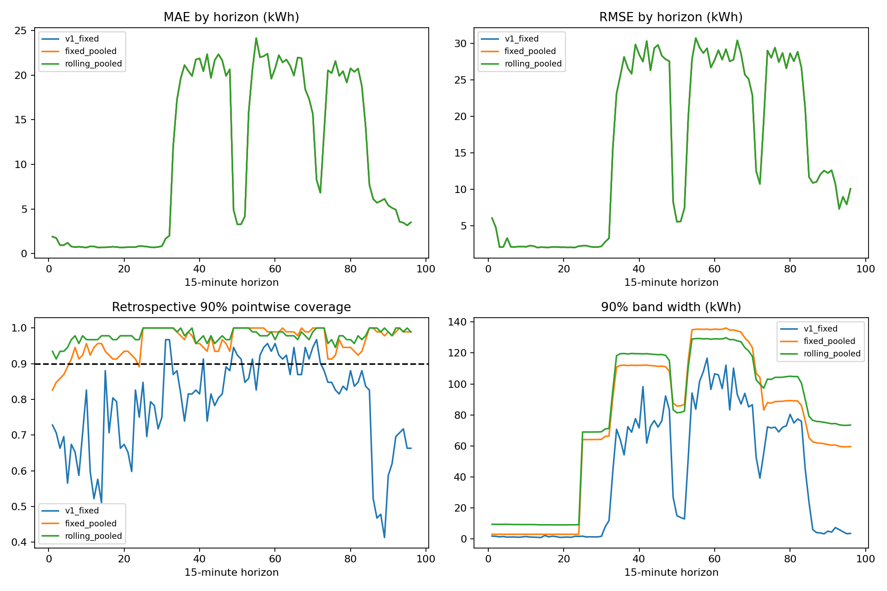
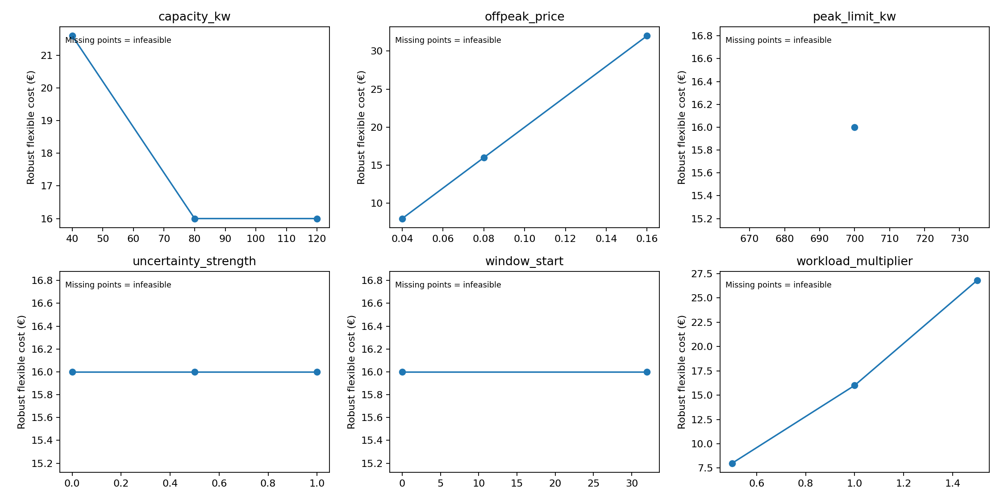

# Version 2 computed results

Results are read from `artifacts/v2/` and `reports/v2/`. V1 evidence remains preserved separately. V2's point forecasts are unchanged; this upgrade changes uncertainty and decision analysis, not point accuracy. October–December was already inspected in V1, so all new comparisons there are **retrospective**. No independent external data or prospective intervention evaluation is available.

## Development selection

Diagnostic settings are selected on January–March training and April–June validation, then refitted through June. July–August residuals calibrate September development forecasts. The fixed development coverage-floor/width rule selects **`v1_fixed`**, because it meets both floors with much narrower bands. We retain that default rather than changing the selector after viewing retrospective results. Rolling pooled bands remain a clearly labeled alternative.

| Method | 80% pointwise coverage | Width, kWh | 90% pointwise coverage | Width, kWh |
|---|---:|---:|---:|---:|
| Selected fixed horizon-wise | 78.61% | 33.90 | 90.21% | 45.00 |
| Fixed six-hour pooled | 95.63% | 64.89 | 98.44% | 73.92 |
| Rolling six-hour pooled | 95.97% | 62.89 | 97.92% | 72.43 |

Pooled nominal levels describe maximum-error calibration within each six-hour bin. Their pointwise coverage naturally tends to be conservative; the table is not a like-for-like nominal pointwise probability guarantee. Selection used this predeclared operational coverage/width criterion, without the inspected original test entering the rule.

## Retrospective uncertainty

There are 92 daily origins and 8,832 interval predictions. The original selected-model MAE remains 10.870 and RMSE 19.408 kWh per interval. The original weekly baseline MAE remains 12.942.

| Method | 80% pointwise coverage | Mean width, kWh | 90% pointwise coverage | Mean width, kWh |
|---|---:|---:|---:|---:|
| Selected V1 fixed horizon-wise | 69.95% | 31.60 | 78.70% | 41.63 |
| Fixed six-hour pooled | 93.10% | 61.52 | 96.26% | 73.64 |
| Alternative rolling pooled | 95.60% | 67.13 | 97.93% | 79.04 |

Alternative rolling 90% bands are approximately 1.90 times as wide as the original horizon-wise bands. Greater coverage is purchased with substantially wider bands and a different score target; it is not evidence of a new independent generalization improvement.

| Alternative rolling score level | Pointwise | Six-hour simultaneous | Whole-day simultaneous |
|---|---:|---:|---:|
| 80% | 95.60% | 77.17% | 42.39% |
| 90% | 97.93% | 88.04% | 61.96% |

The **88.04% six-hour** result is distinct from V1's **88.04% whole-day** result from its separately calibrated, much wider day-maximum band. Equality of rounded numbers is coincidental. The alternative rolling V2 90% construction does **not** provide 90% whole-day coverage.

For high-demand intervals above the frozen training threshold, 90% rolling-alternative band coverage is only **84.31%** across 274 intervals, versus **98.36%** for the other 8,558 intervals. High-demand prediction bias is **−50.45 kWh/interval**; average weekday/weekend bias is approximately +0.92/+1.22. Peak-risk underprediction remains a substantive limitation despite conservative aggregate coverage.

Monthly rolling-alternative 90% pointwise coverage/width is October **97.35% / 77.16 kWh**, November **97.53% / 81.70 kWh**, December **98.89% / 78.36 kWh**. Daily mean-width standard deviation is **10.16 kWh**, with largest adjacent-day change **29.05 kWh**. Width changes reflect calibration changes and nonnegative lower-bound clipping, which also affects fixed-method average widths as predictions change.

## Frozen-decision retrospective backtest

Each policy receives identical 200 kWh hypothetical work, availability, capacities, illustrative time-of-use tariff and cap. Historical complete residual profiles generate twelve supplied scenarios before each origin; the robust schedule must obey all of them. Subsequently observed background is used only to evaluate issued allocations.

| Cap, kW | Deterministic feasible / 92 | Robust feasible / 92 | Deterministic observed-background violation days / feasible days | Paired feasible origins |
|---|---:|---:|---:|---:|
| 350 | 78 | 0 | 36 / 78 | 0 |
| 500 | 92 | 0 | 19 / 92 | 0 |
| 700 | 92 | 18 | 0 / 92 | 18 |

At 350 kW, the deterministic policy incurred 408 violated intervals, six newly caused by added workload rather than background-only exceedance. At 500 kW it incurred 52 violated intervals, all already exceeded by background itself. At these caps the robust method issued no schedule, so there is **no paired violation reduction estimate**. Refusal to issue a schedule is not successful risk protection.

At 700 kW, both policies had zero violations on the 18 paired feasible origins and mean modeled costs of **€214.42**. The deterministic policy had no observed-background violations on all 92 origins at this loose cap. These experiments do not establish that robust scheduling reduced violations or cost. They show substantial conservatism and lost operational availability under the configured residual/stress set.

Development evidence has the same qualitative trade-off: robust issuance is 0/30 at 350 and 500 kW and 9/30 at 700 kW. Deterministic issuance is 29/30, 30/30 and 30/30; observed-background violation days are respectively 10/29, 3/30 and 0/30. On the nine 700 kW paired development days, both policies have zero violations and identical mean modeled costs of **€147.18**.

Solver runtime is recorded per decision. These small continuous LPs typically take milliseconds, while background-only infeasibility can be returned before solving. Runtime is machine-dependent, not a production latency guarantee.

## Guided uncertainty case and sensitivity

The recorded case is the first chronological development origin where both policies are feasible, September 2 at 700 kW; it is not selected for favorable savings. Both cost optima allocate 200 kWh with flexible cost **€16**, and both have the same central-profile total modeled cost **€130.82**. The robust supplied-scenario optimized costs have descriptive mean **€265.50** and maximum **€935.67**; these scenario summaries are not calibrated expected future charges. Envelope costs must not be compared with central-profile costs.

Sensitivity retains this case's 700 kW base cap while varying other inputs; it includes tighter caps, residual strength, workload, shared capacity, off-peak price and start-window restriction. Infeasible combinations remain explicit. The illustrative tariff and ample off-peak flexibility can leave deterministic and robust optimal energy charges equal; this does not imply that robustness is free under all operational constraints.

A separate small hand-calculated fixture demonstrates a robust cost premium when uncertain cheap-slot headroom forces allocation into an expensive slot. It establishes mathematical behavior under synthetic inputs, not an observed factory benefit. Its one-hour intervals, one-kWh job, prices €1/€3 per kWh, and backgrounds [0,0] versus [1,0] produce flexible costs €1 deterministic versus €3 robust. The nominal plan violates the adverse 1 kW cap; the robust shared plan satisfies both supplied paths. These deliberately synthetic prices and durations are not the industrial tariff case.

## Scientific conclusion

The upgrade supplies more useful empirical uncertainty diagnostics, causal scenario provenance, exact finite-set shared-schedule feasibility and honest decision backtests. It does not establish independent forecast reliability, universal robust-policy improvement, realized industrial savings or reduced emissions. Wider bands and conservative scenario sets require operational judgment; additional years, realistic task constraints and prospective decision evidence remain priorities.

Sensitivity on the September 2 case gives flexible cost €21.60 at 40 kW shared capacity versus €16.00 at 80/120 kW. Increasing workload to 300 kWh costs €26.80; 100 kWh costs €8.00. A 22:00 start restriction and 1.5 uncertainty strength are infeasible. These changes demonstrate capacity and conservatism limits, not observed business outcomes.
