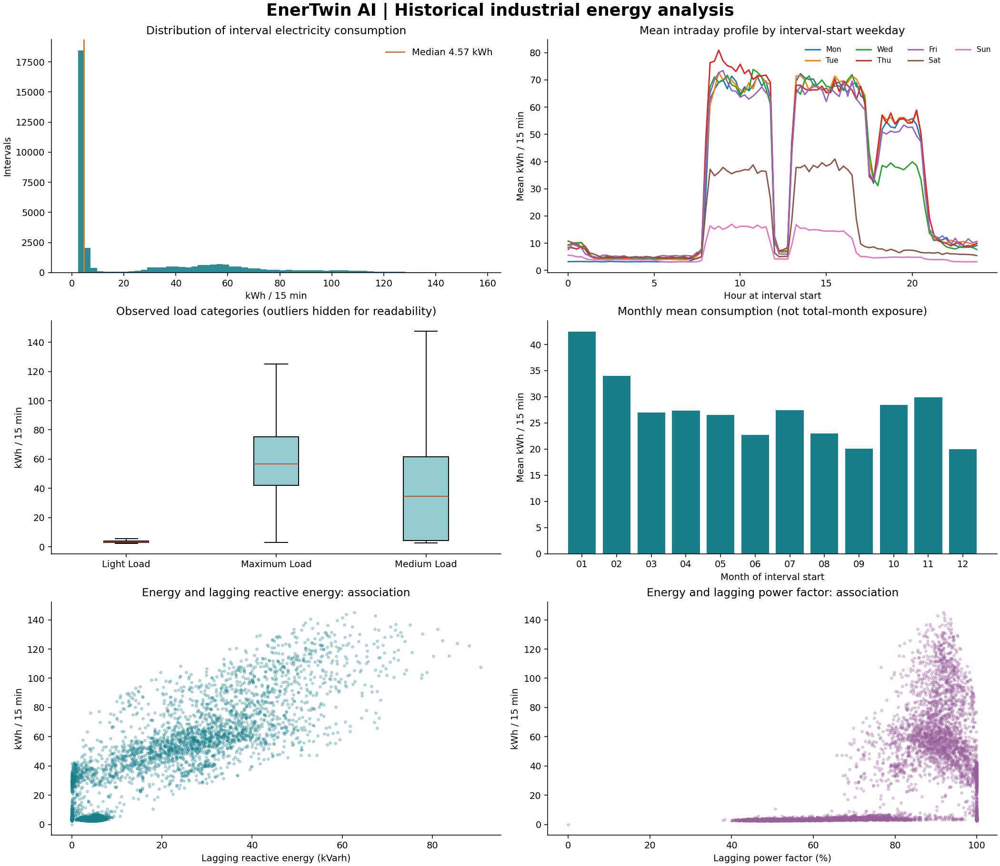
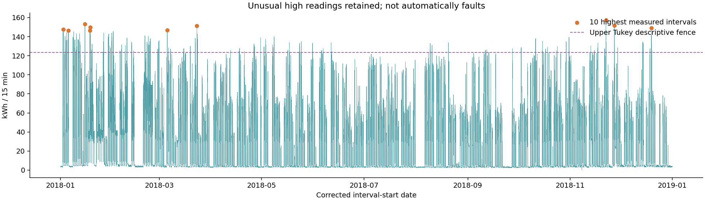

# Historical industrial energy analysis

The validated series contains **35,040 quarter-hour observations**, totaling **959,636.71 kWh**. Calendar summaries use corrected `interval_start`, from 2018-01-01 00:00:00 through 2018-12-31 23:45:00.

Consumption median is 4.57 kWh per interval, with quartiles 3.20 and 51.24 kWh. Mean is 27.39 and standard deviation 33.44 kWh. The largest reading is 157.18 kWh, equivalent to **628.72 kW interval-average demand**. This is not a verified instantaneous or billing-demand peak.

## Observational operating categories

| Category | Intervals | Mean kWh | Median kWh | Q25–Q75 kWh |
|---|---:|---:|---:|---:|
| Light_Load | 18,072 | 8.63 | 3.31 | 2.95–4.03 |
| Maximum_Load | 7,272 | 59.27 | 56.63 | 42.00–75.31 |
| Medium_Load | 9,696 | 38.45 | 34.44 | 4.42–61.70 |

Load categories are observed classifications. Their consumption differences do not establish the effect of changing production schedules, and categories are not assumed known for a future forecast horizon.

## Reactive energy and power factors

| Variable | Pearson r with consumption | Median | Q25–Q75 |
|---|---:|---:|---:|
| Lagging_Current_Reactive.Power_kVarh | 0.896 | 5.00 | 2.30–22.64 |
| Leading_Current_Reactive_Power_kVarh | -0.325 | 0.00 | 0.00–2.09 |
| Lagging_Current_Power_Factor | 0.386 | 87.96 | 63.32–99.02 |
| Leading_Current_Power_Factor | 0.354 | 100.00 | 99.70–100.00 |

Reactive energy uses kVarh and power-factor fields use percent, following the documented variable definitions. Correlations are descriptive and can reflect common operating regimes, timing and scale; they are not causal estimates. Contemporaneous reactive readings and power factors are excluded from deployed future-horizon predictors.

## Calendar variation and unusual readings

| Month | Intervals | Total kWh | Mean interval kWh |
|---|---:|---:|---:|
| 2018-01 | 2,976 | 126,238.29 | 42.42 |
| 2018-02 | 2,688 | 91,497.34 | 34.04 |
| 2018-03 | 2,976 | 80,230.41 | 26.96 |
| 2018-04 | 2,880 | 78,769.80 | 27.35 |
| 2018-05 | 2,976 | 79,059.28 | 26.57 |
| 2018-06 | 2,880 | 65,404.64 | 22.71 |
| 2018-07 | 2,976 | 81,674.41 | 27.44 |
| 2018-08 | 2,976 | 68,559.43 | 23.04 |
| 2018-09 | 2,880 | 57,883.07 | 20.10 |
| 2018-10 | 2,976 | 84,665.65 | 28.45 |
| 2018-11 | 2,880 | 86,217.61 | 29.94 |
| 2018-12 | 2,976 | 59,436.78 | 19.97 |

Monthly totals differ partly because months have different exposure. The figure therefore compares monthly interval means. Weekday profiles summarize observed averages rather than guaranteed future production patterns.

The upper Tukey fence is 123.29 kWh; 328 intervals exceed it. Such readings are descriptive extremes, not evidence of sensor errors or plant faults, and are retained. The highest ten readings are preserved in `eda_summary.json`.

These summaries use the full historical dataset for descriptive analysis. They are not training transformations or model-selection inputs; forecasting and uncertainty evaluation retain separate chronological boundaries. A single facility and single observed year limit external generalization. The source emissions field is excluded from emissions interpretation because its documentation has unresolved units; scenario emissions use explicitly assumed factors.
